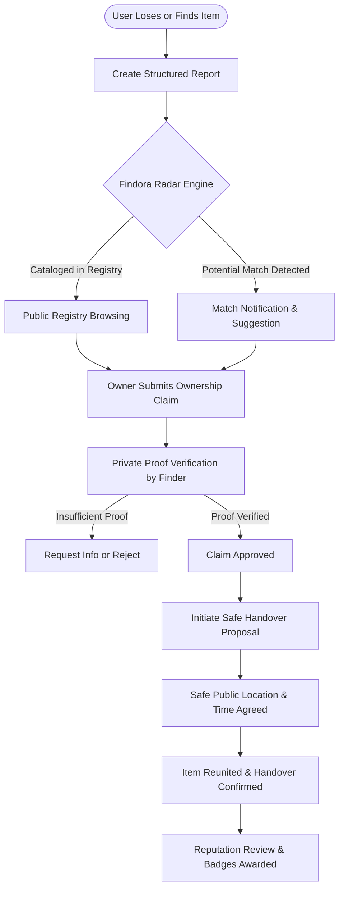

<div align="center">

# 🧭 Findora — Lost & Found Recovery Platform

**A Modern, Privacy-Preserving, Community-Powered Lost & Found Ecosystem**

[](https://findora.zabedmahmud.com/)
[](https://nextjs.org/)
[](https://react.dev/)
[](https://tailwindcss.com/)
[](https://www.mongodb.com/)
[](https://www.better-auth.com/)

[**Explore Live Application →**](https://findora.zabedmahmud.com/)

---

</div>

## 📌 Executive Overview

Every day, countless valuable items—passports, laptops, wallets, keys, and sentimental keepsakes—are misplaced in transit hubs, campuses, and public spaces. The existing solutions are fractured and outdated: lamppost flyers get torn down, social media posts get buried by algorithms, and central lost-and-found desks operate in isolated silos.

**Findora** is a centralized, digital-first recovery platform engineered to bridge the gap between people who lose items and good samaritans who find them. It replaces unverified public inquiries with a structured, fraud-resistant workflow featuring geolocation tracking, private ownership verification, safe handover facilitation, and a community reputation engine.

---

## 🚨 The Problem It Solves

| Traditional Lost & Found Shortcoming | How Findora Solves It |
| :--- | :--- |
| **High Search Friction**<br>Scattered social media posts and disparate notice boards make searching exhausting. | **Centralized Discovery & Search Radar**<br>Categorized, geo-tagged registries with full-text search, live filtering, and automated match discovery. |
| **Fraudulent & Sham Claims**<br>Scammers opportunistically claim valuable found items in public comment sections. | **Private Proof-of-Ownership Verification**<br>Claimants must supply confidential details (serial numbers, hidden marks, receipts) reviewed securely by the finder. |
| **Dangerous Physical Exchanges**<br>Strangers meeting in secluded locations at odd hours risks personal safety. | **Safe Handover Protocol**<br>Integrated exchange coordination recommending public safe zones (police stations, transit concourses) with safety checklists. |
| **Lack of Accountability & Trust**<br>No historical record of whether a finder or claimant is trustworthy or malicious. | **Trust & Reputation Engine**<br>Verified community ratings, badges, and automated flagging for suspicious behavioral patterns. |

---

## ⚡ Key Features

### 🔍 1. Smart Registry & Radar Matching
- **Dual Flow Reporting**: Structured multi-step forms for both **Lost** items and **Found** items with image uploaders and location pinpoints.
- **Search Radar**: Real-time attribute matching comparing item categories, timeframes, and coordinates to automatically suggest potential matches.

### 🛡️ 2. Privacy-First Ownership Verification (Claims Hub)
- **Structured Claims Workflow**: Users submit claims with proof of ownership without exposing sensitive identifying markers to the public.
- **Finder Review Modal**: Finders review answers, request supplemental evidence, or approve/reject claims with full audit trails.

### 🤝 3. Safe Handover Coordination
- **Handover Scheduling**: Propose safe meeting locations, dates, and times.
- **Risk Assessment & Scam Threat Matrix**: Built-in safety warnings flag high-risk exchange conditions (e.g., late-night unpopulated locations).
- **Handover Resolution**: Both parties confirm receipt, closing the loop and marking items as successfully reunited.

### 🌟 4. Community Reviews & Trust Score
- **Interactive Star Rating & Badges**: Users leave verified reviews upon successful recovery.
- **Finder Leaderboards**: Recognizes top community members for honest returns.

### 📊 5. Comprehensive Admin & Analytics Dashboard
- **Admin Moderation**: Review reported listings, resolve contested claims, track fraud, and manage user permissions.
- **Interactive Analytics**: Data visualization powered by Recharts (recovery trends, category distribution, and top incident hot-spots).

---

## 🔄 End-to-End Recovery Lifecycle



---

## 🛠️ Tech Stack & Architecture

### **Frontend**
- **Framework**: [Next.js 16 (Turbopack, App Router)](https://nextjs.org/)
- **Library**: [React 19](https://react.dev/)
- **Styling**: [Tailwind CSS v4](https://tailwindcss.com/), [HeroUI](https://heroui.com/)
- **Animations**: [Framer Motion / Motion](https://motion.dev/)
- **Icons**: [Lucide React](https://lucide.dev/)
- **State & Data Fetching**: [TanStack React Query v5](https://tanstack.com/query)
- **Forms & Validation**: [React Hook Form](https://react-hook-form.com/) + [Zod](https://zod.dev/)
- **Charts & Data Viz**: [Recharts](https://recharts.org/)
- **Notifications**: React Hot Toast

### **Backend & Authentication**
- **Runtime**: Node.js & Express.js
- **Database**: [MongoDB](https://www.mongodb.com/) via [Mongoose](https://mongoosejs.com/)
- **Authentication**: [Better-Auth](https://www.better-auth.com/) with native MongoDB adapter
- **Security**: Role-Based Access Control (RBAC), secure HTTP-only cookies, input sanitization

### **Deployment & Infrastructure**
- **Frontend Hosting**: [Vercel](https://vercel.com/)
- **Custom Domain & SSL**: [findora.zabedmahmud.com](https://findora.zabedmahmud.com/)
- **Version Control**: Git & GitHub

---

## 👥 Engineering Team & Component Contributions

The Findora frontend architecture was built modularly through cross-functional teamwork:

| Team Member | Components Contributed | Core Functional Areas & Scope |
| :--- | :---: | :--- |
| **Zabed Mahmud** | **40** | **Lead Architect**: Core application architecture, Reports ecosystem (form, grid, details, matching), Dashboard analytics & KPI suite, Reviews & Star Rating engine, Auth & RBAC pipelines, Navigation & global layout shell. |
| **Shariful Islam** | **13** | **Feature Engineer**: Handover workflows, Safe Handover proposal & simulator, Claims review modals, Verification processes, Report abuse and feedback components. |
| **Raisha** | **7** | **UI/UX Engineer**: Trust & safety interfaces, Scam Threat Matrix, Trust Hero showcases, Trust FAQ accordion, and community safety guidelines. |
| **Alomgir** | **6** | **Search & Discovery Specialist**: Search radar scanners, Radar result cards, Search filter panels, sorting dropdowns, and category selectors. |
| **Anuj** | **4** | **Component Specialist**: Reusable atomic UI elements, status badges, empty states, card skeletons, and custom pagination modules. |

**Total Components Built**: **70+ custom components**

---

## 📁 Project Directory Structure

```text
Findora/
├── backend/                         # Express.js REST API & Mongoose schemas
│   ├── src/
│   │   ├── config/                  # DB connection and environment configs
│   │   ├── controllers/             # Item, Claim, Handover, and User controllers
│   │   ├── middleware/              # Auth verification and role checks
│   │   ├── models/                  # Mongoose models (Item, Claim, Handover, User)
│   │   ├── routes/                  # API endpoints
│   │   └── server.js                # Server entry point
│   └── package.json
│
├── frontend/                        # Next.js 16 Web Application
│   ├── src/
│   │   ├── app/                     # App Router pages & layout routes
│   │   │   ├── (auth)/              # Login, register, forgot password
│   │   │   ├── (dashboard)/         # User & Admin dashboards
│   │   │   ├── reports/             # Browse, report item, and item details
│   │   │   ├── claims/              # Active claims and verification
│   │   │   ├── handovers/           # Handover scheduling & tracking
│   │   │   ├── trust/               # Trust & safety education hub
│   │   │   └── radar/               # Automated matching radar
│   │   ├── components/              # Modular UI components
│   │   │   ├── admin/               # Charts, analytics, moderation tools
│   │   │   ├── auth/                # Sign-in/up forms and profile settings
│   │   │   ├── claims/              # Claim submission & review modals
│   │   │   ├── dashboard/           # Data tables, KPI cards, charts
│   │   │   ├── handover/            # Handover forms, cards, scheduling
│   │   │   ├── home/                # Hero, how it works, recent reports
│   │   │   ├── layout/              # Navbar, sidebar, footer, topbar
│   │   │   ├── radar/               # Visual radar scanner & result cards
│   │   │   ├── reports/             # Image uploader, report cards, poster
│   │   │   ├── reviews/             # Star ratings, review cards, testimonials
│   │   │   ├── search/              # Search bars, filter panels, type tabs
│   │   │   ├── trust/               # Threat matrix, safety simulator
│   │   │   └── ui/                  # Badges, modals, pagination, skeletons
│   │   ├── hooks/                   # Custom React hooks (useReports, useAuth, etc.)
│   │   ├── lib/                     # Auth client, Axios/fetch utilities, toast
│   │   └── services/                # API service integration layer
│   └── package.json
│
└── README.md
```

---

## 🚀 Getting Started

### Prerequisites
- **Node.js**: `v20.x` or higher
- **npm**: `v10.x` or higher
- **MongoDB**: Local MongoDB instance or MongoDB Atlas URI

### 1. Clone the Repository
```bash
git clone https://github.com/Zabedfolio/Findora.git
cd Findora
```

### 2. Configure Environment Variables

#### Frontend Configuration (`frontend/.env.local`):
```env
NEXT_PUBLIC_APP_URL=http://localhost:3000
NEXT_PUBLIC_API_URL=http://localhost:5000/api
BETTER_AUTH_SECRET=your_better_auth_secret_key
BETTER_AUTH_URL=http://localhost:3000
MONGODB_URI=your_mongodb_connection_string
```

#### Backend Configuration (`backend/.env`):
```env
PORT=5000
MONGODB_URI=your_mongodb_connection_string
JWT_SECRET=your_jwt_secret
CLIENT_URL=http://localhost:3000
```

### 3. Install Dependencies & Run

#### Backend Setup:
```bash
cd backend
npm install
npm run dev
```

#### Frontend Setup:
```bash
cd frontend
npm install
npm run dev
```

Open [http://localhost:3000](http://localhost:3000) in your browser to view the application.

---

## 🔐 Security & Safe Practices

- **Zero Public PII**: Specific private identifiers (e.g. device IMEIs, document ID numbers) are hidden from public indexing and require authenticated verification review.
- **Flagged User Protocol**: Automated heuristic indicators warn parties when communicating with accounts flagged for suspicious or repetitive non-matching claims.
- **Exchange Recommendations**: Built-in reminders advise against secluded exchanges, encouraging brightly lit public locations or verified police station safety zones.

---

## 📄 License & Acknowledgments

This project is licensed under the [MIT License](LICENSE). Built with dedication by the Findora engineering team to make lost item recovery reliable, safe, and community-driven.

For inquiries or suggestions, visit [findora.zabedmahmud.com](https://findora.zabedmahmud.com/).
